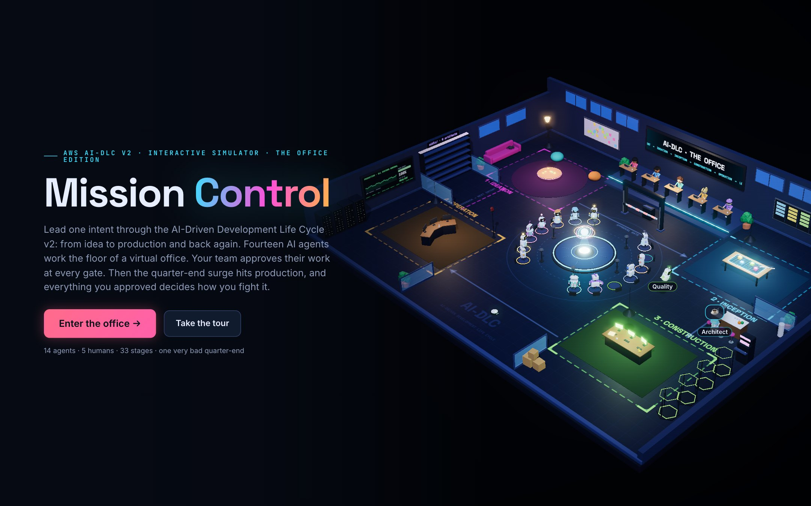
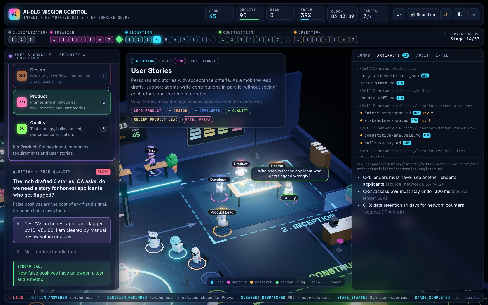
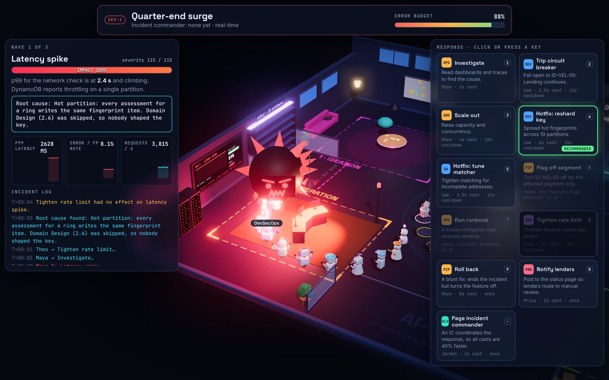

# AI-DLC Mission Control: The Office

A single-file browser game that walks one intent through the AWS AI-Driven Development Life Cycle (AI-DLC) v2, from idea
to production and back again, inside a 3D office. Fourteen AI agents work the floor, five humans approve their work at
every gate, and then the quarter-end surge hits production.



## Play

Open [`v3.html`](v3.html) in a desktop browser. There is no server and no install step; the 3D assets and all code are
embedded in the file. A window at least 1200px wide gives the office the most room.

- **Mouse:** drag to orbit the office, scroll to zoom, double-click to reset the view, hover anyone to see who they are.
- **Keys:** `1`–`4` pick an option, `A` approve, `R` request changes, `Space` skip waiting, `M` sound on/off.
- Choose a seat (Product Owner, Engineering Lead, Delivery Manager, SRE, Security) and a scope (Express, Feature,
  Enterprise). A Feature run takes about 30 minutes; Express about 10.

### Take the tour first

The first time you enter the office, a 13-step guided tour walks you round it: the Conductor, the fourteen agents and what
each one carries, the five humans, the approval gate, the sensors, the record wall, the swarm pods and the incident. Use
`←` `→` to step and `Esc` to skip. Replay it any time from **Take the tour** on the title screen or **Office tour** on the
setup screen.


## What you do

### Predict who leads each stage

Each of the 33 stages has one lead agent. Guess it from the card, or click the bot itself in the office.


### Watch the agents work, and answer what they ask

The lead flies to that phase's room. On the Enterprise scope, collaborators are on, so support agents join the table and
the reviewer stands by. Questions are routed to the human who owns the decision, and your answers carry forward.



### Approve at the gate

Every stage after Initialization stops for a human. The gate owner walks down from the gallery to the approval gate.
Read the artifacts, weigh the sensors and the reviewer's verdict, then approve or request changes.


### Build in a swarm

With a verified walking skeleton and stage-major execution, independent Units build side by side in git worktrees.
Each one gets a drone in a worktree pod.


### Survive the incident

At quarter end the surge arrives as a storm over the Operations room. Your loadout is whatever you approved earlier:
skipped Domain Design means a hot partition, and no feature-flag practice means no way to switch off one segment.



### Read the debrief

The debrief traces each outcome back to the decision that caused it.


There is a light theme too.


## How closely it follows AI-DLC

Stage names and order, modes, lead, support and reviewer agents, conditional flags, the sensors each stage imports, and
each scope's ceremony switches are taken from
[awslabs/aidlc-workflows](https://github.com/awslabs/aidlc-workflows) release 2.11.4 (commit `8c4f79b`).

The game takes these liberties, and says so in its Intel tab:

- Who owns each gate, the scoring, and the ×1.3 Enterprise multiplier are game rules. In AI-DLC every gate is simply a
  human approval.
- "Open risk" notes on stages that have no reviewer are the game's way of surfacing a weak decision.
- Construction follows one Unit; a real run walks every Unit and stops at each Unit checkpoint.
- The scenario (the Identity Risk API, its team and its numbers) and the incident are fiction.

This project is not affiliated with or endorsed by AWS.

## Project layout

| Path | What it is |
|---|---|
| `v3.html` | The built game. |
| `v2.html` | The original 2D simulator, kept for reference. |
| `src/game.html` | Game shell, styles, method data, scenario and engine. |
| `src/office/` | The three.js office: scene, camera, characters, effects, painted screens. |
| `blender/build_assets.py` | Generates every 3D asset (office, 14 agent bots, Conductor, 5 humans, props). |
| `blender/out/office.glb` | The generated asset file that gets embedded in `v3.html`. |
| `build.mjs` | Bundles `src/office` with esbuild and inlines it and the GLB into `v3.html`. |
| `tools/check.mjs` | Parses the built game script so a syntax error fails the build. |
| `tools/screenshots.mjs` | Captures the screenshots in this README. |

The game talks to the office only through the `NET` bridge in `src/game.html`. The office reads room, desk, dock and gate
positions from `A_*` empties in the GLB, so the layout lives in the Blender script alone.

## Build

```bash
npm install
npm run assets        # only after editing blender/build_assets.py (needs Blender 5.x at /Applications/Blender.app)
npm run build         # writes v3.html
npm run screenshots   # optional: recapture docs/screenshots (needs Google Chrome)
```

Method data lives in two places in `src/game.html`: the `UPSTREAM` table (generated from the upstream stage frontmatter)
and `PROFILES` (the scope switches, mirroring `core/scopes/aidlc-{express,feature,enterprise}.md`).

## Autoplay (testing)

`v3.html?auto=1&role=po&prof=feature&speed=60` plays a full run by itself and sets `window.__done` at the debrief.

- `auto=1` best answers · `auto=bad` worst answers and rubber stamps · `auto=fix` worst answers, then request every fix ·
  `auto=hot` best answers except a hot-partition store that is never fixed
- `role` = `po` `eng` `pm` `ops` `sec` · `prof` = `express` `feature` `enterprise`
- `motion=0` reduced motion · `hold=boss` stop at the incident · `slow=3.5` play one stage at normal speed
- `tour=1` opens the office tour directly; add `tourstep=4` to start at a given step

## Third-party

- [three.js](https://threejs.org) (MIT) is bundled into `v3.html`; its licence notice is kept in the bundle.
- Method data is derived from [awslabs/aidlc-workflows](https://github.com/awslabs/aidlc-workflows) (MIT-0).
- Fonts (Space Grotesk, Inter, JetBrains Mono) load from Google Fonts at run time and fall back to system fonts offline.
