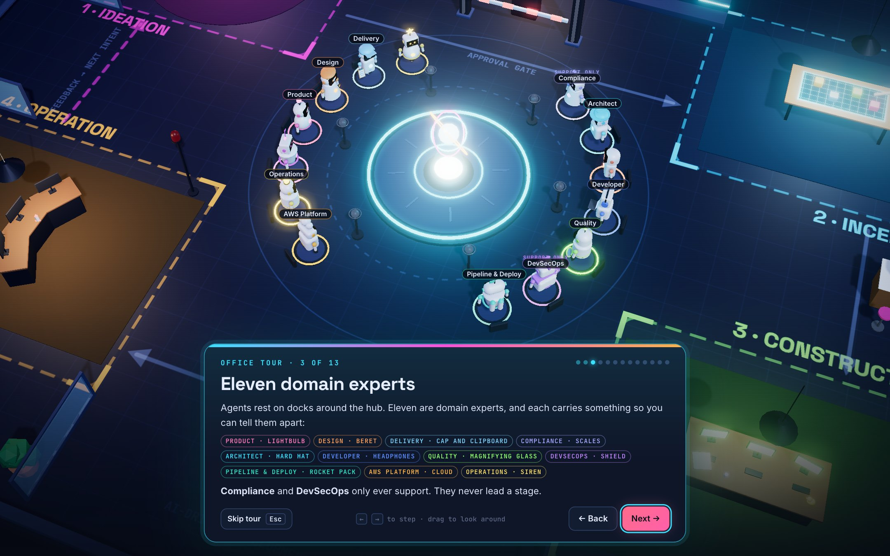
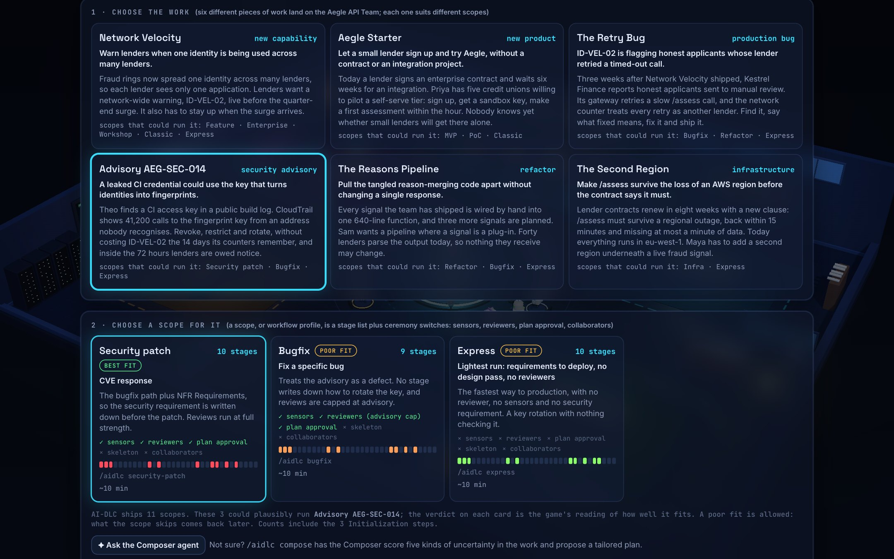
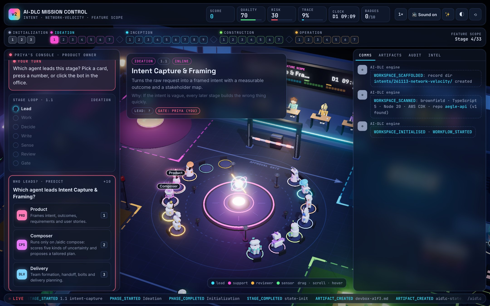
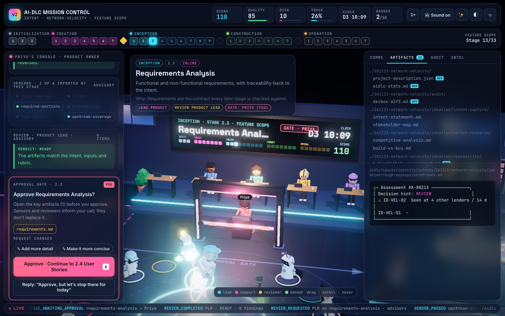
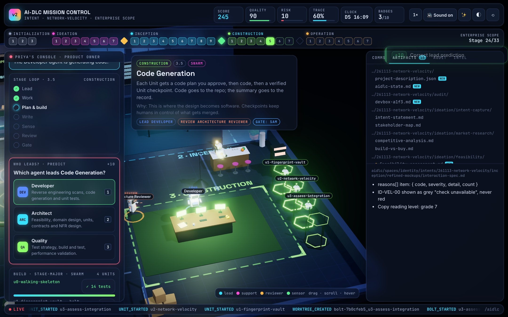
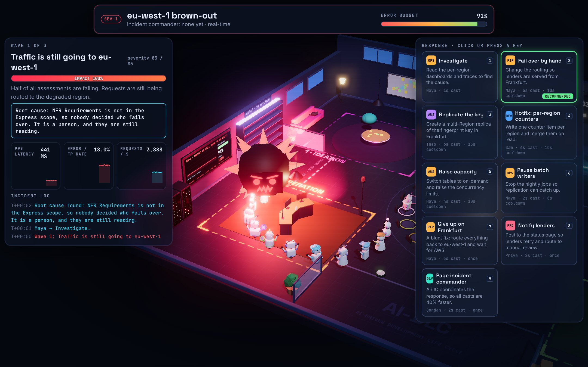
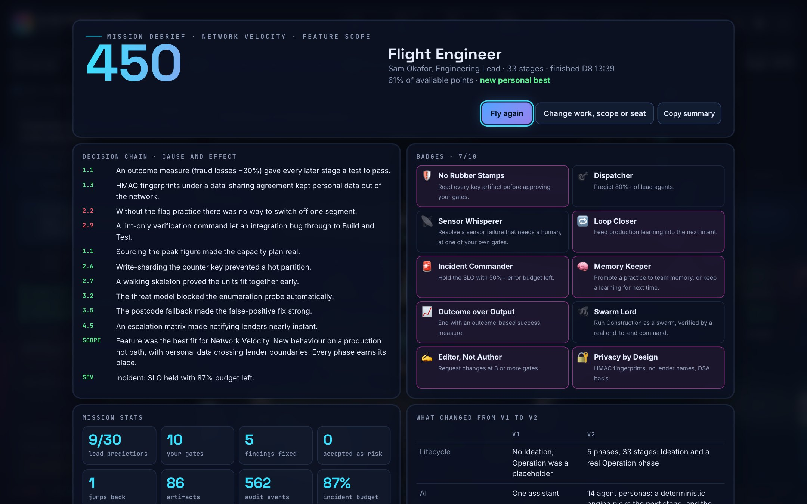
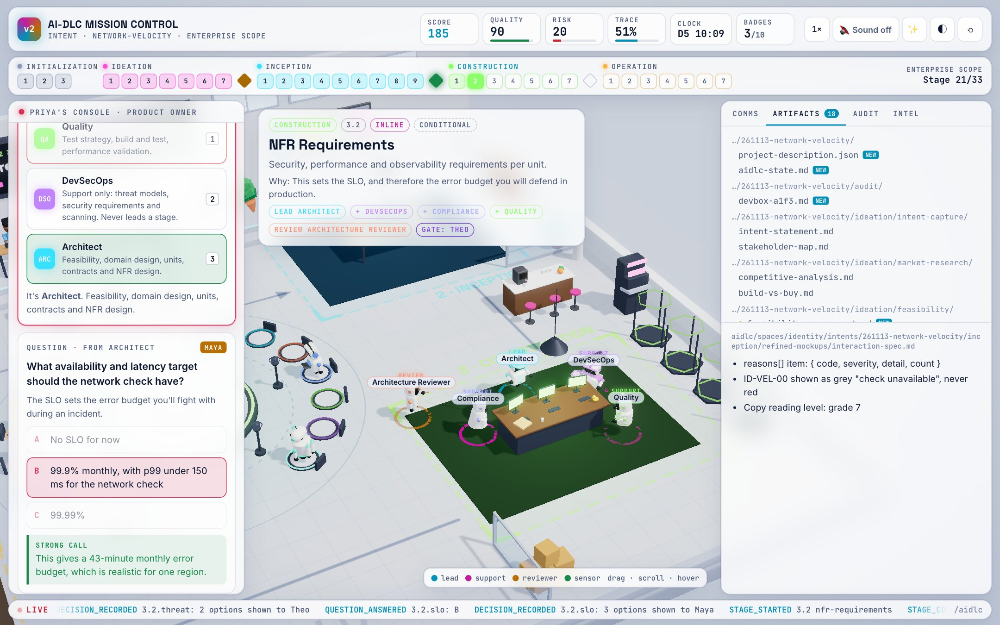

# AI-DLC Mission Control: The Office

A single-file browser game that walks a piece of work through the AWS AI-Driven Development Life Cycle (AI-DLC) v2, from
idea to production and back again, inside a 3D office. Fourteen AI agents work the floor, five humans approve their work
at every gate, and then production pushes back. There are six scenarios to play, and each suits different AI-DLC scopes.


## Play

Open [`v3.html`](v3.html) in a desktop browser. There is no server and no install step; the 3D assets and all code are
embedded in the file. A window at least 1200px wide gives the office the most room.

- **Mouse:** drag to orbit the office, scroll to zoom, double-click to reset the view, hover anyone to see who they are.
- **Keys:** `1`–`4` pick an option, `A` approve, `R` request changes, `Space` skip waiting, `M` sound on/off.
- Choose the work, a scope for it, and a seat (Product Owner, Engineering Lead, Delivery Manager, SRE, Security).
  Network Velocity under the Feature scope takes about 30 minutes; the bug, patch and refactor take about 10.

### Take the tour first

The first time you enter the office, a 13-step guided tour walks you round it: the Conductor, the fourteen agents and what
each one carries, the five humans, the approval gate, the sensors, the record wall, the swarm pods and the incident. Use
`←` `→` to step and `Esc` to skip. Replay it any time from **Take the tour** on the title screen or **Office tour** on the
setup screen.



### Pick the work, then a scope for it

Six pieces of work land on the Aegle API Team. Each one offers only the scopes that could plausibly run it, with the
game's verdict on each: best fit, workable or poor fit. A poor fit is allowed. Whatever the scope skips comes back later,
usually in the incident.



| Scenario | What lands on the team | Best fit | Also offered |
|---|---|---|---|
| **Network Velocity** | A new capability: warn lenders when one identity is used across many lenders. | `feature` | `enterprise`, `workshop`, `classic`, `express` |
| **Aegle Starter** | A new product: a self-serve tier nobody is yet sure small lenders want. | `mvp` | `classic`, `poc` |
| **The Retry Bug** | A production bug: retries from one lender are counted as other lenders. | `bugfix` | `refactor`, `express` |
| **Advisory AEG-SEC-014** | A security advisory: a leaked credential could use the fingerprint key. | `security-patch` | `bugfix`, `express` |
| **The Reasons Pipeline** | A refactor: pull 640 lines of merging code apart without changing a response. | `refactor` | `bugfix`, `express` |
| **The Second Region** | An infrastructure change: survive the loss of an AWS region. | `infra` | `express` |

Every scenario has its own questions, artifacts, planted sensor failure, loop-back, incident and debrief. The stories
share one team and one product, and they follow on from each other: the bug is in what Network Velocity shipped.

All 11 shipped scopes appear somewhere. A scope is a stage list plus ceremony switches (sensors, reviewers, plan approval,
walking skeleton, collaborators):

| Scope | Stages | What it is |
|---|---|---|
| `feature` | 33 | Full lifecycle for new features, at practical depth. |
| `enterprise` | 33 | Full lifecycle at Comprehensive depth, Guard Policy strict, collaborators on. |
| `workshop` | 26 | Everything except Ideation, for a facilitated group. Reviews capped at advisory. |
| `mvp` | 23 | Trimmed Ideation, all of Inception and Construction, nothing in Operation. |
| `classic` | 18 | The v1 shape: Inception and Construction, stopping at Build and Test. |
| `infra` | 15 | Infrastructure changes: NFR and infrastructure design, CI, deploy and observability. |
| `express` | 10 | Requirements to deploy with no design pass, reviewers, sensors or plan approval. |
| `refactor` | 10 | The bugfix path plus Functional Design. |
| `security-patch` | 10 | The bugfix path plus NFR Requirements. |
| `bugfix` | 9 | Scan, requirements, fix, test, deploy. |
| `poc` | 8 | Intent, scan, requirements, code and tests. It never deploys. |

When a scope skips a stage the work turns out to need, a gate can pull it back in ("Approve, and add NFR Requirements
next"). Scopes that stop before Deployment Execution (`mvp`, `classic`, `poc`) still meet real users: the team ships by
hand, with nothing in Operation designed.

## What you do

### Predict who leads each stage

Each stage has one lead agent. Guess it from the card, or click the bot itself in the office.



### Watch the agents work, and answer what they ask

The lead flies to that phase's room. On the Enterprise scope, collaborators are on, so support agents join the table and
the reviewer stands by. Questions are routed to the human who owns the decision, and your answers carry forward.


### Approve at the gate

Every stage after Initialization stops for a human. The gate owner walks down from the gallery to the approval gate.
Read the artifacts, weigh the sensors and the reviewer's verdict, then approve or request changes.



### Build in a swarm

With a verified walking skeleton and stage-major execution, independent Units build side by side in git worktrees.
Each one gets a drone in a worktree pod.



### Survive the incident

Every scenario ends with production pushing back, as a storm over the Operations room. In Network Velocity it is the
quarter-end surge. Your loadout is whatever you approved earlier: skipped Domain Design means a hot partition, and no
feature-flag practice means no way to switch off one segment.


Each scenario has its own incident. In The Second Region, eu-west-1 browns out. Here the team ran it under Express, so
no stage ever decided who fails over:



### Read the debrief

The debrief traces each outcome back to the decision that caused it, and says how well the scope you chose fitted the work.



There is a light theme too.



## How closely it follows AI-DLC

Stage names and order, modes, lead, support and reviewer agents, conditional flags, the sensors each stage imports, and
each scope's ceremony switches are taken from
[awslabs/aidlc-workflows](https://github.com/awslabs/aidlc-workflows) release 2.11.4 (commit `8c4f79b`).

The game takes these liberties, and says so in its Intel tab:

- Who owns each gate, the scoring, and the ×1.3 Enterprise multiplier are game rules. In AI-DLC every gate is simply a
  human approval.
- "Open risk" notes on stages that have no reviewer are the game's way of surfacing a weak decision.
- Construction follows one Unit; a real run walks every Unit and stops at each Unit checkpoint.
- The scenarios (the Aegle API Team, its product and its numbers) and the incidents are fiction.
- Which scopes each scenario offers, and the best fit, workable and poor fit verdicts, are the game's reading of each
  scope's upstream description.

This project is not affiliated with or endorsed by AWS.

## Project layout

| Path | What it is |
|---|---|
| `v3.html` | The built game. |
| `v2.html` | The original 2D simulator, kept for reference. |
| `src/game.html` | Game shell, styles, method data and engine. It contains no story. |
| `src/scenarios/*.js` | The six scenarios: questions, artifacts, chat, findings, incident and debrief for each. |
| `src/office/` | The three.js office: scene, camera, characters, effects, painted screens. |
| `blender/build_assets.py` | Generates every 3D asset (office, 14 agent bots, Conductor, 5 humans, props). |
| `blender/out/office.glb` | The generated asset file that gets embedded in `v3.html`. |
| `build.mjs` | Bundles `src/office` with esbuild and inlines it, the scenarios and the GLB into `v3.html`. |
| `tools/check.mjs` | Fails the build on a syntax error, or if scenario wording appears in the engine. |
| `tools/playtest.mjs` | Checks every scenario's data, then autoplays each scenario under each scope it offers. |
| `tools/screenshots.mjs` | Captures the screenshots in this README. |

The engine reads a scenario only through `SCN` (set by `useScenario()`), and talks to the office only through the `NET`
bridge. The office reads room, desk, dock and gate
positions from `A_*` empties in the GLB, so the layout lives in the Blender script alone.

## Build

```bash
npm install
npm run assets        # only after editing blender/build_assets.py (needs Blender 5.x at /Applications/Blender.app)
npm run build         # writes v3.html
npm run playtest      # optional: autoplay every scenario and scope to the debrief (needs Google Chrome)
npm run screenshots   # optional: recapture docs/screenshots (needs Google Chrome)
```

Method data lives in two places in `src/game.html`: the `UPSTREAM` table (generated from the upstream stage frontmatter)
and `PROFILES` (all 11 scopes: stage lists from each stage's `scopes:` frontmatter, switches from `core/scopes/aidlc-<name>.md`).

### Adding a scenario

Copy `src/scenarios/bug.js`, the shortest one, and add its id to `SCEN_ORDER` in `src/game.html`. A scenario lists the
scopes that can run it (`scopes`, `best`, `fit`) and must supply content for every stage those scopes include.
`npm run playtest` checks that, and that every question is asked, every fix target exists, and no artifact quietly shows
the best answer for a decision nobody made (use `pkd()` for a decision from a stage the scope may have skipped).

## Autoplay (testing)

`v3.html?auto=1&scen=velocity&role=po&prof=feature&speed=60` plays a full run by itself and sets `window.__done` at the
debrief.

- `auto=1` best answers · `auto=bad` worst answers and rubber stamps · `auto=fix` worst answers, then request every fix ·
  `auto=hot` best answers except a hot-partition store that is never fixed
- `scen` = `velocity` `product` `bug` `secpatch` `refactor` `infra` · `prof` = a scope that scenario offers
- `role` = `po` `eng` `pm` `ops` `sec`
- `motion=0` reduced motion · `hold=boss` stop at the incident · `slow=3.5` play one stage at normal speed
- `tour=1` opens the office tour directly; add `tourstep=4` to start at a given step

## Third-party

- [three.js](https://threejs.org) (MIT) is bundled into `v3.html`; its licence notice is kept in the bundle.
- Method data is derived from [awslabs/aidlc-workflows](https://github.com/awslabs/aidlc-workflows) (MIT-0).
- Fonts (Space Grotesk, Inter, JetBrains Mono) load from Google Fonts at run time and fall back to system fonts offline.
